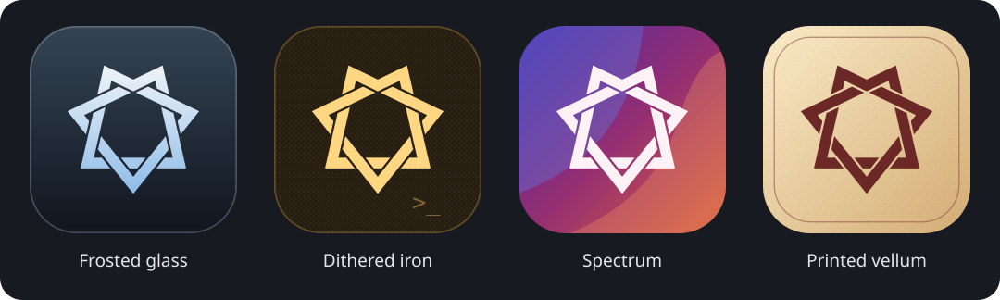

# Nexis family branding

Every Nexis-family launcher icon uses the canonical SVG heptagram as its
topmost layer. The existing [Nexis tile](../assets/brand/nexis-logo.svg)
sets the silhouette, mark scale and placement. An app changes the mark's
color and the composition behind it. The icon and the interface can have
different palettes. In app chrome keep the mark monochrome via
`<NexisMark />` in `currentColor`.

| App character | Icon composition | Mark color |
| --- | --- | --- |
| General Nexis | Frosted glass with a quiet rim. Use the scaffold tile as the starting point. | Frost or a single accent tint with enough contrast. |
| Ferrite or terminal | Iron, phosphor, dither, or an ASCII field behind the mark. A text-only terminal banner can draw the mark in ASCII. | Amber, green phosphor, or neutral ink. Keep the SVG silhouette in the launcher icon. |
| Creative | A gradient, abstract shapes, or a crop of original artwork. Keep the area directly behind the mark quiet enough for its seven points to read at 16 px. | One contrasting fill or a restrained tonal gradient. |
| Editorial or retail | Paper grain, a printer's border, a storefront awning, a paper label, or another material that belongs to the product. | Ink or a compact product accent. |

## When scaffolding an app

Use [the base template that fits the task](../AGENTS.md#1-start-an-app).
Before finalizing a new icon, ask the user one branding question with two
parts. Ask which background composition fits the app and which color the
heptagram should take. Show a small set of options built from the same
geometry when it helps them choose. Reuse decisions the user has already
made. The starter tile gives the app a working icon while the choice is
being made.

For ChatGPT or Codex sessions with image generation, generate the background
alone. Ask for a quiet center and omit logos, letters, and star shapes unless
they are intentional background texture. Place the generated image under the
canonical path in the composed SVG. For Claude, use its SVG generation skill
to create the background as vector layers and add the canonical SVG path as
the last layer. Both workflows keep the mark independently editable and exact.

Keep the heptagram path and placement from the original SVG. Put texture,
type, and decoration behind it, where they cannot cut up the mark. Preview
the launcher tile at 16, 32, and 128 px on both dark and light grounds.
Keep the composed SVG in `assets/logo.svg`, export its 1024×1024 PNG to
`src-tauri/icons/icon.png`, and run `pnpm icons`. Use that same composition
for the README masthead and launcher icon.

## Apps with their own identity

Use a product name and wordmark in product materials, with the heptagram as
the family signature on the launcher, in About, and in the README footer.
This lets the name, content typography, photography or illustration carry
the product identity, while the shared mark remains recognizable on a dock.
Where an app has a legacy mark, it can live in its editorial or marketing
assets. An independently branded product that consumes the library can
choose its own launcher identity. Make that distinction explicit with the
user before changing an established icon.

| Reference | Start from | Borrow | Keep in the product |
| --- | --- | --- | --- |
| BibleLM | `workbench` for the reader and `settings-deep` for settings | Narrow reading columns, serif body text for the reading surface, an illustrated empty state, and a registry for grouped settings. | Scripture typography, blackletter headings, dithered plates, sigils, and the Vellum, Nocturne and Tenebrae themes. For its launcher, try warm vellum with a dark ink heptagram. |
| Vitrine | `explorer`, then shelves and cards for the storefront | `Shelf`, `ProductCard`, `PriceTag`, `CollectionCard`, `FilterPanel`, and optional motion from `CardTilt`. | Awnings, sale stickers, and the app's levels of showmanship. For its launcher, try a storefront stripe or paper price label with a high-contrast heptagram. |

Keep these recipes as short references in Nexis Design, with the complete
visual direction owned by the app. Pick one reference per app. Inherit
component defaults, then customize the activity that defines the product
such as reading or browsing. This gives an agent a starting point without
turning every component into a theme decision.

[Asset manifest](ASSETS.md) · [BibleLM design notes](https://github.com/rwetz/biblelm/blob/main/docs/DESIGN.md) · [Vitrine component findings](APP-FINDINGS.md#vitrine-2026-11-10-brought-up-to-23e14a7)
